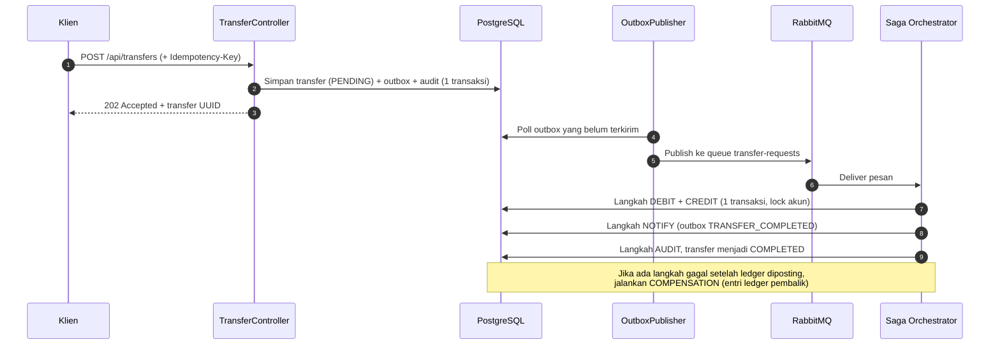
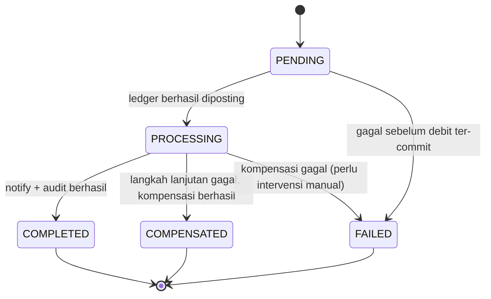

# Transaction Coordinator & Ledger Service

Layanan Spring Boot yang mengkoordinasikan transfer antar akun dan mencatat
setiap operasi ke **ledger double-entry** di PostgreSQL. Transfer diproses
secara asinkron melalui RabbitMQ dengan **saga pattern (orchestration)**,
dilengkapi idempotency, pessimistic locking, JWT auth, rate limiting, dan
audit log.

## Daftar Isi

1. [Fitur Utama](#fitur-utama)
2. [Teknologi](#teknologi)
3. [Arsitektur](#arsitektur)
4. [Menjalankan dengan Docker](#menjalankan-dengan-docker)
5. [Konfigurasi (Environment Variable)](#konfigurasi-environment-variable)
6. [Autentikasi dan Otorisasi](#autentikasi-dan-otorisasi)
7. [API](#api)
8. [Skema Database](#skema-database)
9. [Double-Entry Ledger](#double-entry-ledger)
10. [Concurrency dan Locking](#concurrency-dan-locking)
11. [Idempotency](#idempotency)
12. [Saga Pattern](#saga-pattern)
13. [2PC vs Saga](#2pc-vs-saga)
14. [Keamanan](#keamanan)
15. [Testing](#testing)
16. [Keterbatasan yang Diketahui](#keterbatasan-yang-diketahui)

---

## Fitur Utama

- `POST /api/transfers` dengan validasi, publish ke queue, dan response UUID.
- Ledger double-entry: setiap transfer menghasilkan satu entri `DEBIT` dan satu
  `CREDIT` yang seimbang, diverifikasi sebelum commit.
- Idempotency melalui header `Idempotency-Key` dan `reference` yang unik.
- Saga 4 langkah (debit, credit, notify, audit) dengan compensating transaction
  dan pencatatan lengkap di `saga_log`.
- Transactional outbox agar pesan ke RabbitMQ tidak hilang.
- Pessimistic locking (`SELECT ... FOR UPDATE`) pada baris akun.
- JWT, role `USER`/`ADMIN`, isolasi akun, rate limiting, dan audit log.
- Dokumentasi API interaktif melalui Swagger UI.

## Teknologi

| Komponen | Teknologi |
| --- | --- |
| Bahasa / Framework | Java 21, Spring Boot |
| Database | PostgreSQL 17 (migrasi dengan Flyway) |
| Message broker | RabbitMQ 4 |
| Security | Spring Security OAuth2 Resource Server (JWT HS256), BCrypt |
| Build | Maven Wrapper (`./mvnw`) |
| Container | Docker, Docker Compose |

## Arsitektur

### Alur pemrosesan transfer



### Status transfer



Status `COMPLETED`, `FAILED`, dan `COMPENSATED` bersifat terminal. Pesan yang
dikirim ulang untuk transfer terminal diabaikan.

### Struktur paket

| Paket | Tanggung jawab |
| --- | --- |
| `transfer` | Endpoint transfer, validasi, idempotency, DTO |
| `saga` | Orchestrator, langkah-langkah saga, listener RabbitMQ, endpoint saga log |
| `ledger` | Entitas dan repository `ledger_entries` |
| `account` | Entitas akun, endpoint saldo dan ledger akun |
| `outbox` | Transactional outbox dan publisher terjadwal |
| `audit` | Entitas dan repository `audit_log` |
| `auth` | Registrasi, login, penerbitan JWT, bootstrap admin |
| `security`, `config` | Rate limiter, konfigurasi security, RabbitMQ, OpenAPI |

## Menjalankan dengan Docker

Siapkan kunci HMAC JWT Base64 minimal 256 bit, lalu jalankan aplikasi beserta
dependensinya:

```bash
export JWT_SECRET_BASE64="$(openssl rand -base64 32)"
export BOOTSTRAP_ADMIN_USERNAME="ledger-admin"
export BOOTSTRAP_ADMIN_PASSWORD="ganti-dengan-password-acak-yang-panjang"
docker compose up --build
```

Layanan yang berjalan:

| Layanan | Alamat |
| --- | --- |
| API | `http://localhost:8080` |
| Swagger UI | `http://localhost:8080/swagger-ui/index.html` |
| OpenAPI JSON | `http://localhost:8080/v3/api-docs` |
| Health check | `http://localhost:8080/actuator/health` |
| PostgreSQL | `localhost:5437` |
| RabbitMQ AMQP / UI | `localhost:5672` / `http://localhost:15672` |

Port PostgreSQL dan RabbitMQ dibuka hanya untuk kebutuhan pengembangan lokal.
Untuk produksi gunakan kredensial yang dikelola secara eksternal, TLS, rate
limiter terdistribusi, dan kontrol jaringan pada database dan broker.

Variabel bootstrap bersifat opsional dan digunakan untuk membuat akun `ADMIN`
pertama. Isi keduanya atau tidak sama sekali; password harus 12–72 byte UTF-8.
Jika dikosongkan, registrasi publik hanya bisa membuat akun `USER`, sehingga
admin harus disiapkan secara terpisah.

## Konfigurasi (Environment Variable)

| Variable | Default | Keterangan |
| --- | --- | --- |
| `JWT_SECRET_BASE64` | *(wajib)* | Kunci HMAC Base64, minimal 256 bit |
| `BOOTSTRAP_ADMIN_USERNAME` | kosong | Username admin pertama |
| `BOOTSTRAP_ADMIN_PASSWORD` | kosong | Password admin pertama (12–72 byte) |
| `DB_URL` | `jdbc:postgresql://localhost:5437/ledger_db` | JDBC URL |
| `DB_USERNAME` / `DB_PASSWORD` | `ledger_user` / `ledger_password` | Kredensial database |
| `RABBITMQ_HOST` / `RABBITMQ_PORT` | `localhost` / `5672` | Alamat broker |
| `RABBITMQ_USERNAME` / `RABBITMQ_PASSWORD` | `ledger_user` / `ledger_password` | Kredensial broker |
| `RATE_LIMIT_REQUESTS` | `60` | Jumlah request maksimum per jendela per IP |
| `RATE_LIMIT_WINDOW` | `PT1M` | Durasi jendela (format ISO-8601) |
| `OUTBOX_POLL_INTERVAL_MS` | `500` | Interval polling outbox (ms) |

Jangan memakai kredensial default atau kunci JWT pengembangan di produksi.

## Autentikasi dan Otorisasi

Registrasi publik hanya membuat role `USER`. Login mengembalikan JWT HS256 yang
ditandatangani dengan `JWT_SECRET_BASE64` dan berlaku **satu jam**. Token
memuat `sub` (UUID user) dan klaim `roles`.

| Role | Hak akses |
| --- | --- |
| `USER` | Hanya akun miliknya; dapat membaca transfer jika memiliki salah satu akun yang terlibat |
| `ADMIN` | Seluruh akun dan transfer |

Daftarkan user:

```bash
curl -X POST http://localhost:8080/api/auth/register \
  -H 'Content-Type: application/json' \
  -d '{"username":"alice","password":"password-panjang-yang-unik"}'
```

Tukar kredensial dengan JWT:

```bash
curl -X POST http://localhost:8080/api/auth/token \
  -H 'Content-Type: application/json' \
  -d '{"username":"alice","password":"password-panjang-yang-unik"}'
```

Gunakan `access_token` yang dikembalikan sebagai header
`Authorization: Bearer <token>`. Username tidak membedakan huruf besar/kecil,
dan password disimpan sebagai hash BCrypt.

### Menyiapkan akun untuk pengujian

Pembuatan akun sengaja berada di luar API transfer. Gunakan UUID user hasil
registrasi sebagai `owner_user_id`. Contoh untuk database pengembangan:

```sql
INSERT INTO accounts
    (account_number, owner_user_id, account_name, currency, balance, status)
VALUES
    ('A-10001', '11111111-1111-1111-1111-111111111111',
     'Akun contoh', 'USD', 250.0000, 'ACTIVE');
```

Untuk membuat dua akun dummy dan 20 transfer contoh yang saling merujuk melalui
`from_account_id` dan `to_account_id`, daftarkan setidaknya satu user terlebih
dahulu, lalu jalankan seed khusus pengembangan berikut:

```bash
docker compose exec -T postgres psql -U ledger_user -d ledger_db \
  < src/main/resources/db/seed/dev_seed.sql
```

Seed mengaitkan akun dummy dengan user terdaftar paling awal. Semua transfer
contoh berstatus `FAILED` agar tidak mengubah saldo; eksekusi ulang tidak
menambahkan duplikat. Seed ini bukan migration dan tidak dijalankan otomatis.

## API

Semua endpoint `/api/**` kecuali `/api/auth/**` memerlukan JWT. Di Swagger UI,
klik **Authorize** lalu masukkan token dari `/api/auth/token`.
Untuk melihat contoh request pada `POST /api/transfers`, buka operasinya,
klik **Try it out**, lalu gunakan contoh JSON yang sudah tersedia.

| Method | Path | Deskripsi |
| --- | --- | --- |
| `POST` | `/api/auth/register` | Mendaftarkan user (role `USER`) |
| `POST` | `/api/auth/token` | Login dan mengambil JWT |
| `GET` | `/api/accounts` | Daftar akun milik pengguna (admin melihat semua) |
| `POST` | `/api/transfers` | Membuat transfer (asinkron) |
| `GET` | `/api/transfers` | Daftar transfer yang dapat diakses pengguna |
| `GET` | `/api/transfers/{id}` | Detail transfer beserta ledger entries |
| `GET` | `/api/transfers/reference/{reference}` | Cari transfer berdasarkan reference |
| `GET` | `/api/accounts/{id}/balance` | Saldo dan mata uang akun |
| `GET` | `/api/accounts/{id}/ledger` | Seluruh ledger entries akun (terbaru dulu) |
| `GET` | `/api/saga/log/{transfer_id}` | Riwayat langkah saga |

### Memilih akun dan melihat daftar transfer

Gunakan `GET /api/accounts` untuk mendapatkan akun yang dapat dipakai. Respons
berisi `accountId`, yang digunakan sebagai `from_account_id` atau
`to_account_id` saat membuat transfer. Pengguna hanya melihat akun miliknya;
admin dapat melihat semua akun.

```bash
curl http://localhost:8080/api/accounts \
  -H "Authorization: Bearer $ACCESS_TOKEN"
```

Gunakan `GET /api/transfers` untuk melihat transfer yang dapat diakses, termasuk
`transferId` dan `reference`. Pengguna hanya melihat transfer yang melibatkan
akun miliknya; admin dapat melihat semua transfer.

```bash
curl http://localhost:8080/api/transfers \
  -H "Authorization: Bearer $ACCESS_TOKEN"
```

Nilai `reference` dibuat oleh klien dan dikirim di body `POST /api/transfers`;
nilainya wajib dan unik. Untuk mengambil detail satu transfer menggunakan
reference tersebut:

```bash
curl "http://localhost:8080/api/transfers/reference/invoice-1001" \
  -H "Authorization: Bearer $ACCESS_TOKEN"
```

Jika reference berisi karakter khusus, URL-encode nilainya.

### Membuat transfer

`POST /api/transfers` mewajibkan header `Idempotency-Key` (1–100 karakter).
Nama field akun menerima camelCase maupun snake_case (`from_account` atau
`from_account_id`, `to_account` atau `to_account_id`).

```bash
curl -X POST http://localhost:8080/api/transfers \
  -H "Authorization: Bearer $ACCESS_TOKEN" \
  -H 'Content-Type: application/json' \
  -H 'Idempotency-Key: payment-2026-0001' \
  -d '{
    "from_account_id": "11111111-1111-1111-1111-111111111111",
    "to_account_id": "22222222-2222-2222-2222-222222222222",
    "amount": 10.2500,
    "currency": "USD",
    "reference": "invoice-1001"
  }'
```

Response `202 Accepted` berisi UUID transfer dan status awal `PENDING`.
Permintaan ditulis ke transactional outbox dalam transaksi yang sama dengan
transfer, kemudian dipublikasikan ke RabbitMQ. Pemrosesan berjalan asinkron;
pantau hasilnya lewat `GET /api/transfers/{id}` dan `GET /api/saga/log/{transfer_id}`.

### Validasi

- `amount` minimal `0.0001`, maksimal 15 digit bulat dan 4 digit desimal.
- `currency` tepat 3 karakter dan harus sama dengan mata uang kedua akun.
- `reference` wajib, maksimal 100 karakter, unik.
- Akun asal dan tujuan harus berbeda dan berstatus `ACTIVE`.
- Pengirim harus pemilik akun asal.

### Kode response

| Kode | Arti |
| --- | --- |
| `202` | Transfer diterima |
| `400` | Validasi gagal (termasuk header `Idempotency-Key` tidak valid) |
| `401` | Token tidak ada atau tidak valid |
| `404` | Resource tidak ada **atau** bukan milik pemanggil |
| `409` | Idempotency key dipakai dengan request berbeda, atau `reference` sudah ada |
| `429` | Rate limit terlampaui |

Resource yang tidak ada dan resource yang tidak boleh diakses sama-sama
mengembalikan `404` agar keberadaan akun atau transfer tidak terungkap.

## Skema Database

Migrasi dikelola Flyway (`src/main/resources/db/migration`).

| Tabel | Fungsi | Constraint penting |
| --- | --- | --- |
| `accounts` | Akun dan saldo | `balance >= 0`, `account_number` unik, status `ACTIVE/FROZEN/CLOSED` |
| `transfers` | Permintaan transfer | `reference` unik, `idempotency_key` unik, `amount > 0`, `from <> to` |
| `ledger_entries` | Entri debit/kredit | `entry_type IN (DEBIT, CREDIT)`, `amount > 0` |
| `saga_log` | Jejak eksekusi saga per langkah | status langkah dibatasi CHECK |
| `audit_log` | Jejak audit (JSONB) | terkait ke `transfers` |
| `outbox_events` | Transactional outbox | indeks pada `(published, created_at)` |
| `app_users` | User dan role | `username` unik, role `USER/ADMIN` |

Semua nominal memakai `NUMERIC(19,4)` (`BigDecimal` di aplikasi), tanpa
floating point.

## Double-Entry Ledger

Setiap posting ledger yang berhasil:

1. mengunci kedua akun,
2. memeriksa status akun, kecocokan mata uang, dan kecukupan saldo,
3. mengurangi saldo akun asal dan menambah saldo akun tujuan,
4. menyisipkan satu entri `DEBIT` dan satu entri `CREDIT`,
5. **memverifikasi bahwa total debit sama dengan total kredit** untuk transfer
   tersebut, lalu baru commit.

Jika verifikasi atau langkah apa pun gagal sebelum commit, transaksi
di-rollback sehingga kedua sisi tidak pernah tersimpan setengah-setengah.
Entri ledger tidak pernah dihapus atau diubah oleh aplikasi; koreksi dilakukan
dengan entri pembalik (kompensasi).

## Concurrency dan Locking

### Keputusan: pessimistic locking pada baris akun

Layanan ini memakai `SELECT ... FOR UPDATE` (JPA `PESSIMISTIC_WRITE`) pada
kedua akun yang terlibat, serta pada baris transfer saat langkah saga
dijalankan. Kunci diambil **berurutan berdasarkan UUID** sehingga dua transfer
yang saling berlawanan arah (A→B dan B→A) tidak saling menunggu secara
melingkar (deadlock).

Alasannya:

- Akun populer (hot account) dapat menerima banyak transfer bersamaan. Dengan
  lock, pengecekan saldo dan pembaruan saldo diserialisasi sehingga tidak ada
  *lost update* maupun *overdraft*.
- Pada sistem keuangan, konflik tidak boleh sekadar ditolak lalu diulang secara
  acak; menunggu giliran lebih dapat diprediksi.
- Transaksi yang mengunci sangat pendek: hanya posting ledger, tanpa
  pemanggilan jaringan di dalamnya.

### Pessimistic vs optimistic locking

| Aspek | Pessimistic (`SELECT FOR UPDATE`) | Optimistic (kolom `version`) |
| --- | --- | --- |
| Mekanisme | Mengunci baris sebelum dibaca/diubah; transaksi lain menunggu | Tidak mengunci; konflik terdeteksi saat commit (`UPDATE ... WHERE version = ?`) |
| Saat konflik | Transaksi lain menunggu | Salah satu gagal dan **harus mengulang seluruh operasi** |
| Biaya | Lock ditahan selama transaksi, risiko deadlock jika urutan tidak konsisten | Murah jika konflik jarang, mahal jika konflik sering (banyak retry) |
| Cocok untuk | Baris dengan kontensi tinggi dan invarian ketat | Data dengan kontensi rendah |

**Kapan untuk sistem ledger:**

- **Pessimistic** untuk saldo akun dan transisi status transfer, karena
  kontensinya bisa tinggi dan invarian (saldo tidak boleh negatif) tidak boleh
  dilanggar.
- **Optimistic** cocok untuk data berkontensi rendah seperti profil atau
  metadata akun, atau jika beban dipastikan jarang bertabrakan dan retry
  aman dilakukan.
- Tabel `ledger_entries` bersifat *append-only* (hanya INSERT) sehingga pada
  dasarnya tidak memerlukan lock baris.

## Idempotency

**Idempotency key** adalah pengenal unik dari satu operasi logis klien yang
dikirim ulang pada setiap percobaan ulang. Server mengenali key tersebut dan
mengembalikan hasil yang sama alih-alih mengeksekusi operasi untuk kedua kali.

**Mengapa kritis untuk API pembayaran:** klien sering mengulang request ketika
terjadi timeout atau koneksi putus, padahal server mungkin sudah memproses
transfer dan hanya response-nya yang hilang. Tanpa idempotency, percobaan ulang
dapat menimbulkan **pembayaran ganda**. Dengan idempotency, retry aman dilakukan.

Implementasi di layanan ini:

- Key dikirim lewat header `Idempotency-Key` dan disimpan di kolom
  `transfers.idempotency_key` dengan constraint `UNIQUE` (unik **secara global**
  pada tabel, bukan per user).
- Request ulang dengan key yang sama dan isi yang sama mengembalikan transfer
  yang sudah ada (tanpa transfer baru).
- Key yang sama dengan isi berbeda (akun, nominal, mata uang, atau reference)
  ditolak dengan `409 Conflict`.
- **Request bersamaan** dengan key yang sama: constraint `UNIQUE` di database
  menjadi penjaga terakhir. Hanya satu insert yang berhasil, yang lain
  menerima `409`; klien cukup mengulang request dan akan mendapat transfer
  yang sudah ada.
- `reference` adalah pengenal bisnis yang diberikan klien dan juga `UNIQUE`.
  Jadi, `reference` yang sama dengan key berbeda ditolak dengan `409`.
- **Keduanya bukan hal yang sama:** `Idempotency-Key` digunakan untuk
  mengenali retry dari operasi logis yang sama, sedangkan `reference` menjaga
  keunikan referensi bisnis. `reference` membantu mencegah duplikasi, tetapi
  tidak menggantikan header `Idempotency-Key` yang wajib.
- Di sisi pemrosesan, setiap langkah saga memeriksa `saga_log` dan status
  terminal, sehingga pesan RabbitMQ yang terkirim ulang (at-least-once) tidak
  memposting ledger dua kali.

## Saga Pattern

**Saga** adalah pola untuk menjaga konsistensi pada alur kerja yang melibatkan
beberapa langkah atau resource tanpa satu transaksi terdistribusi. Saga
dipecah menjadi serangkaian *transaksi lokal*; setiap langkah yang sudah
ter-commit memiliki *compensating transaction* yang membatalkan efek bisnisnya
bila langkah berikutnya gagal. Konsistensinya bersifat *eventual*, bukan
atomik seketika.

### Langkah saga pada layanan ini

| # | Langkah | Aksi | Kompensasi |
| --- | --- | --- | --- |
| 1 | `DEBIT` | Kurangi saldo akun asal, catat entri `DEBIT` | Entri `CREDIT` pembalik |
| 2 | `CREDIT` | Tambah saldo akun tujuan, catat entri `CREDIT` | Entri `DEBIT` pembalik |
| 3 | `NOTIFY` | Tulis event `TRANSFER_COMPLETED` ke outbox (queue `transfer-notifications`) | Event `TRANSFER_COMPENSATED` |
| 4 | `AUDIT` | Tulis `audit_log`, tandai transfer `COMPLETED` | Entri audit `TRANSFER_COMPENSATED` |

Langkah `DEBIT` dan `CREDIT` dicatat sebagai dua baris `saga_log` terpisah,
tetapi perubahan ledger dan saldonya dieksekusi dalam **satu transaksi
database** agar invarian double-entry tidak pernah rusak di tengah jalan.

### Penanganan kegagalan

- Gagal **sebelum** ledger ter-commit (misalnya saldo tidak cukup): transaksi
  di-rollback, langkah gagal dicatat, transfer menjadi `FAILED`.
- Gagal **sesudah** ledger ter-commit (misalnya pada `NOTIFY` atau `AUDIT`):
  dijalankan `COMPENSATION` berupa entri ledger pembalik, diverifikasi
  seimbang, dan transfer menjadi `COMPENSATED`.
- Kompensasi sendiri gagal: kegagalan dicatat di `saga_log`, transfer menjadi
  `FAILED`, dan perlu intervensi manual.
- Seluruh eksekusi saga, termasuk kegagalan dan kompensasi, dicatat di
  `saga_log` dan dapat dibaca lewat `GET /api/saga/log/{transfer_id}`.

### Orchestration vs choreography

| Aspek | Orchestration | Choreography |
| --- | --- | --- |
| Kendali alur | Satu koordinator mengarahkan setiap langkah dan kompensasi | Tiap layanan bereaksi terhadap event layanan lain |
| Keterlacakan | Mudah: alur dan status ada di satu tempat | Sulit: alur tersebar di banyak layanan |
| Kopling | Koordinator mengenal semua langkah | Longgar, tanpa titik pusat |
| Risiko | Koordinator menjadi titik pusat yang harus andal | Ketergantungan siklik dan alur sulit dipahami |

**Pilihan: orchestration.** Transfer finansial membutuhkan urutan yang
eksplisit, status langkah yang tersimpan, jejak audit yang jelas, dan jalur
kompensasi yang terdefinisi. Semua itu lebih mudah dijamin dengan koordinator
tunggal (`TransferSagaService`) yang mencatat setiap langkah ke `saga_log`.

### Transactional outbox

Event ke RabbitMQ tidak dikirim langsung dari transaksi bisnis. Event ditulis
ke tabel `outbox_events` dalam transaksi yang sama dengan perubahan data, lalu
`OutboxPublisher` mengirimnya secara berkala. Ini menghindari kondisi di mana
data ter-commit tetapi pesan hilang (atau sebaliknya). Pengiriman bersifat
*at-least-once*, sehingga konsumen dibuat idempotent.

## 2PC vs Saga

| Aspek | Two-Phase Commit (2PC) | Saga |
| --- | --- | --- |
| Cara kerja | Fase *prepare* lalu *commit* serentak di semua resource | Transaksi lokal berurutan; kegagalan ditangani kompensasi |
| Atomisitas | Atomik: semua commit atau semua batal | Eventual: efek sementara terlihat, pembatalan lewat kompensasi |
| Syarat | Semua resource manager mendukung protokol 2PC (XA) | Tiap resource menyediakan transaksi lokal dan aksi kompensasi idempoten |
| Locking | Lock ditahan sampai koordinator memutuskan; jika koordinator mati, resource bisa tertahan | Lock hanya selama transaksi lokal |
| Skalabilitas dan ketersediaan | Dapat membatasi ketersediaan saat koordinator atau partisipan bermasalah | Cocok untuk alur terdistribusi/berdurasi panjang, dengan kompleksitas dan konsistensi eventual |
| Rollback | Rollback sungguhan | Kompensasi bersifat bisnis dan tidak selalu bisa mengembalikan keadaan persis |

**Kapan memakai:**

- **2PC** bila semua partisipan mendukungnya, jumlahnya sedikit dan berada di
  lingkungan terpercaya, serta atomisitas ketat wajib (misalnya beberapa
  database dalam satu domain administratif).
- **Saga** bila alur melibatkan layanan yang dimiliki tim berbeda, resource
  yang tidak transaksional (broker pesan, layanan notifikasi, API eksternal),
  atau proses yang berjalan lama dan harus tetap tersedia.

Layanan ini memakai saga karena alurnya melibatkan PostgreSQL dan RabbitMQ yang
tidak berbagi satu transaksi.

## Keamanan

| Kontrol | Implementasi |
| --- | --- |
| Autentikasi | JWT HS256, kedaluwarsa 1 jam, kunci minimal 256 bit (aplikasi menolak kunci yang lebih pendek) |
| Otorisasi | Role `USER` dan `ADMIN`; endpoint bisnis `/api/**` memerlukan salah satunya, kecuali `/api/auth/**` yang publik |
| Isolasi akun | Query kepemilikan pada akun, transfer, dan saga log; akses tidak sah dijawab `404` |
| Password | BCrypt |
| Rate limiting | 60 request per IP per menit (dapat dikonfigurasi), termasuk endpoint `/api/auth/**` |
| Audit log | Dicatat untuk `TRANSFER_REQUESTED`, `TRANSFER_COMPLETED`, `TRANSFER_FAILED`, `TRANSFER_COMPENSATED` |
| Integritas data | Constraint database (`CHECK`, `UNIQUE`, foreign key), `NUMERIC` untuk nominal |

## Testing

Jalankan unit test dengan:

```bash
./mvnw test
```

Cakupan test saat ini:

| Kelas test | Yang diuji |
| --- | --- |
| `AuthServiceTests` | Registrasi dengan password ter-hash dan role `USER`, JWT valid, kredensial salah, registrasi duplikat |
| `SagaStepServiceTests` | Posting debit/kredit seimbang beserta pembaruan saldo, penolakan saldo tidak cukup tanpa entri ledger |
| `TransferSagaServiceTests` | Urutan langkah saga, kompensasi saat langkah non-ledger gagal, `FAILED` bila gagal sebelum debit, melewati transfer yang sudah terminal |
| `CreateTransferRequestTests` | Deserialisasi field snake_case yang dicontohkan di Swagger dan kompatibilitas camelCase |
| `AccountControllerTests` | Daftar akun pengguna menggunakan query yang dibatasi berdasarkan pemilik |
| `TransferControllerTests` | Role `USER` dan `ADMIN` diteruskan dengan cakupan akses yang sesuai ke service daftar transfer |

Tes controller di atas adalah unit test dengan repository/service mock; tes
tersebut tidak menggantikan integration test untuk memastikan konfigurasi
security dan isolasi akses bekerja melalui HTTP. Belum tercakup dan
direkomendasikan sebagai pengembangan berikutnya: test `TransferService`
(idempotency dan validasi), integration test controller/security, test
konkurensi untuk membuktikan tidak terjadi overdraft, dan integration test
dengan Testcontainers (PostgreSQL + RabbitMQ).

## Keterbatasan yang Diketahui

- **Kompensasi dapat gagal.** Pembalikan mendebit akun tujuan dengan pengecekan
  saldo. Jika penerima sudah menggunakan dananya, kompensasi gagal, transfer
  berstatus `FAILED`, dan dibutuhkan penanganan manual.
- **Rate limiter in-memory.** Berlaku per instance aplikasi dan berdasarkan
  alamat IP langsung; di belakang reverse proxy semua klien bisa terlihat
  sebagai satu IP. Gunakan rate limiter terdistribusi untuk produksi.
- **Header `Idempotency-Key` wajib.** Klien yang hanya mengirim `reference`
  akan menerima `400`.
- **Pembuatan akun di luar API.** Akun harus disiapkan lewat proses onboarding
  atau SQL langsung.
- **Endpoint ledger tanpa pagination.** `GET /api/accounts/{id}/ledger`
  mengembalikan seluruh entri.
- **Sifat append-only ledger dijaga di level aplikasi**, belum oleh trigger atau
  hak akses database.
- **Kredensial default di `docker-compose.yml`** hanya untuk pengembangan lokal.
- **Belum ada sharding, read replica, atau multi-region.** Aplikasi memakai satu
  PostgreSQL write database; target 10K+ TPS dan latency <100 ms belum
  diukur atau dijamin. Perlu definisi SLO serta benchmark dengan beban realistis.
- **Belum mendukung konversi FX.** Kedua akun harus memakai mata uang yang sama;
  transfer lintas mata uang, quote FX, dan settlement clearing belum tersedia.
- **Idempotency masih pada tabel transfer dan pemrosesan saga**, belum berupa
  registry global lintas region/semua sistem.
- **Belum ada circuit breaker, retry policy terkonfigurasi, atau DLQ khusus.**
  Outbox dipoll ulang, tetapi itu bukan jaminan kebijakan retry produksi.
- **Audit belum memiliki WORM storage atau retensi tujuh tahun yang ditegakkan.**
  Tabel audit database saja tidak menjamin immutable retention.
- **Belum ada kontrol AML/KYC atau sanctions screening.** Layanan ini belum
  menyatakan atau menjamin kepatuhan terhadap regulasi pembayaran lintas negara.
